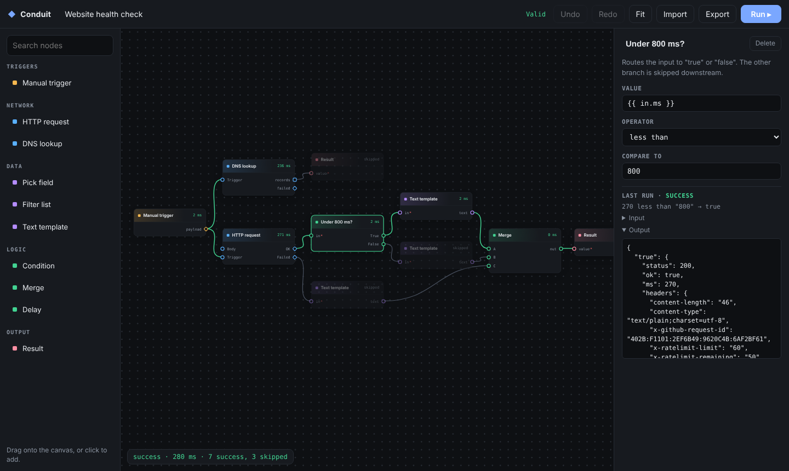

# Conduit

**A low-code workflow builder that runs entirely in the browser.** Wire typed nodes together on a canvas, get the graph validated as you build, and run it with parallel, cancellable, branch-aware execution — then inspect every node's inputs, outputs and logs.

**Live demo:** https://jamie-233.github.io/conduit/



## Features

- **Canvas editor** — pan, zoom around the cursor, trackpad gestures, 8 px snap (hold <kbd>Alt</kbd> to disable), drag-and-drop from the palette, wire by dragging between ports.
- **Typed ports** — `string`, `number`, `boolean`, `object`, `array`, `any`. Incompatible connections and loops are refused *as you drag*, with the reason shown.
- **Live validation** — missing required inputs, ambiguous fan-in, cycles, unknown node types and missing triggers, highlighted on the node.
- **Parallel execution** — a node starts the moment its last input resolves; a slow branch never blocks an unrelated one. Concurrency is capped to protect rate-limited APIs.
- **Branching without control-flow nodes** — a node can leave an output port empty; downstream nodes that receive nothing are skipped, and the skip propagates. Conditions, error routes and merges all fall out of that one rule.
- **Timeouts and cancellation** — every node gets an `AbortSignal`; a run can be stopped mid-flight, and a node that ignores its signal still can't hang the run.
- **Safe templating** — `{{ input.payload.host }}` in any text field, by path lookup only: no `eval`, no prototype walking. A field that is exactly one placeholder keeps the value's type.
- **Undo / redo** — snapshot-based, with rapid edits (a node drag, typing in a field) coalesced into one step.
- **Import / export** — versioned JSON with migrations, validated on import because shared workflow files are untrusted input. Autosaves locally.

## Nodes

| Category | Nodes |
|---|---|
| Triggers | Manual trigger |
| Network | HTTP request (`ok` / `failed` ports), DNS lookup over DNS-over-HTTPS |
| Data | Pick field, Filter list, Text template |
| Logic | Condition (`true` / `false`), Merge, Delay |
| Output | Result |

## Getting started

```bash
npm install
npm run dev        # http://localhost:5173
npm test           # engine test suite
npm run build      # static site in dist/
```

Shortcuts: <kbd>⌘/Ctrl</kbd>+<kbd>Enter</kbd> run · <kbd>⌘/Ctrl</kbd>+<kbd>Z</kbd> undo · <kbd>⇧</kbd>+<kbd>⌘/Ctrl</kbd>+<kbd>Z</kbd> redo · <kbd>⌘/Ctrl</kbd>+<kbd>S</kbd> export · <kbd>Del</kbd> delete selection · <kbd>F</kbd> fit view.

## Architecture

```
src/
  engine/            framework-free core, fully unit-tested
    types.ts         plain-data document model
    graph.ts         topological sort, cycle detection, connection rules, validation
    executor.ts      dependency-counting scheduler with skip propagation
    template.ts      {{ path }} interpolation without evaluation
    history.ts       snapshot undo/redo with coalescing
    serialize.ts     versioned import/export and migrations
  nodes/             node library — each node is one self-describing object
  composables/       editor state; every mutation goes through commit()
  components/        canvas, node card, palette, inspector
```

### Design decisions

**Documents are plain data; behaviour lives in node definitions.** A workflow is JSON with no functions or class instances, so it can be stored, diffed and undone trivially. Node behaviour is looked up by `type` at run time, which means adding a node kind never changes the file format.

**Dependency counting instead of level-by-level execution.** Running "all nodes at depth 1, then depth 2…" makes every level wait for its slowest member. Counting unresolved inputs per node and starting it the moment the count hits zero gives the maximum parallelism any DAG allows.

**Skip propagation instead of control-flow constructs.** An edge resolves either with a value or as *skipped*. A node runs if any input carries a value and is skipped if all are skipped. That single rule produces if/else (Condition), error handling (HTTP's `failed` port) and joins (Merge) without a special branch type in the graph.

**Kahn's algorithm for validation.** It yields the run order and, in the same pass, exactly the set of nodes on or downstream of a cycle — what the editor needs to highlight. A DFS would find one back-edge and stop.

**Snapshots over the command pattern for undo.** Commands need a hand-written inverse per edit type, and one wrong inverse silently corrupts history. The document is small, so whole snapshots are cheap and can't drift from the editing code.

**Port positions are computed, not measured.** Deriving them from the model keeps wires and nodes in the same reactive update, so wires never lag behind a dragged node.

### Adding a node

```ts
{
  type: 'data.uppercase',
  label: 'Uppercase',
  category: 'Data',
  description: 'Converts text to upper case.',
  inputs: [{ name: 'in', type: 'string', required: true }],
  outputs: [{ name: 'out', type: 'string' }],
  fields: [],
  async run({ inputs }) {
    return { out: String(inputs.in).toUpperCase() }
  },
}
```

The palette entry, inspector form and validation rules are generated from this object.

## License

MIT
